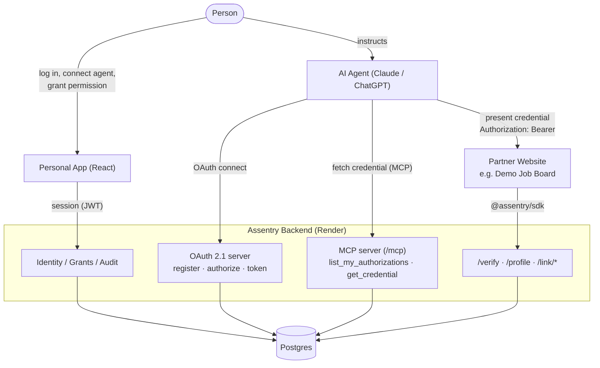

# Assentry Architecture

## The flow, step by step

1. **A person creates their identity** in the Personal App and connects an agent — not by pasting a key, but by adding Assentry's `/mcp` address in their AI's own connector settings, which redirects them to an Assentry login/consent screen. Approving it is what creates the `Agent` record.
2. **The person authorises that agent** to act on their behalf, with specific data fields and an expiry — a `Grant`. Nothing is granted just by connecting. No separate per-action scope for now (see `STRATEGY.md`).
3. **The agent asks Assentry what it's allowed to do** (`list_my_authorizations`) and, right before acting, asks for a fresh, short-lived credential (`get_credential`) — both over MCP, authenticated by the OAuth access token from step 1. The credential contains no personal data, only IDs and expiry.
4. **The agent presents that credential to a participating website**, as a standard `Authorization: Bearer` header — Assentry's job ends here. What the agent does with the credential (apply for a job, read content, whatever the task is) is the agent's and the website's business, not Assentry's.
5. **The website verifies independently**, via `@assentry/sdk`, which calls Assentry's `/verify` (and optionally `/profile`, which only discloses the specific fields the grant consented to, live, not baked into the credential). The website decides what the verified identity is allowed to do on its own — including recognising an existing account (implicit email matching, or an explicit one-time linking flow), with no further Assentry-hosted step.
6. **Every verification, disclosure, and grant action is logged**, visible to the person who owns the identity, not just to whoever built the agent or the website.

## What's deliberately *not* in this diagram

- Assentry never touches the partner website directly — no arrow from Assentry to Partner. That's the agent's job.
- There's no arrow from Partner back into Assentry's identity database — the website keeps its own account records; Assentry only ever answers "is this credential valid, and what does it disclose."
- A plain login gate a website never adapted for Assentry isn't reachable by any of this, by design (see `STRATEGY.md`, §9, case 3).
