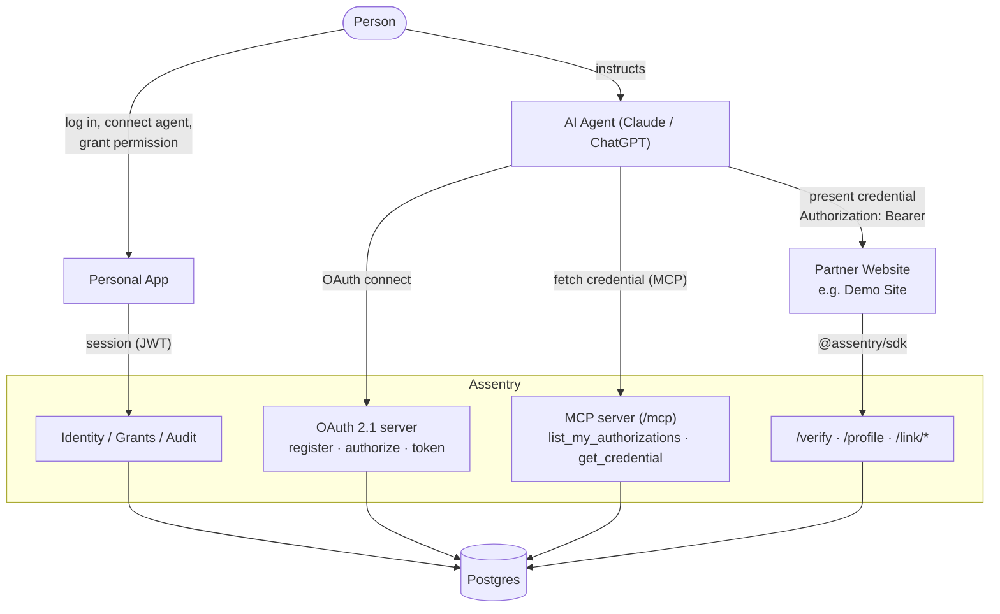

# Assentry Architecture

## The flow, step by step

1. **A person creates their identity** in the Personal App and connects an agent by adding Assentry's `/mcp` address in their AI's connector settings. That sends them to Assentry's login and consent page; approving it creates the `Agent` record. The AI app gets a one-hour access token and a single-use refresh token, renewed as it goes.
2. **The person authorises that agent** with specific details and an expiry: a `Grant`. Connecting alone grants nothing.
3. **The agent signs in to a site.** In a browser, the site (through `@assentry/sdk`) shows a sign-in code; the agent approves it over MCP (`approve_sign_in`) with the domain from its address bar, and the site collects a credential bound to its verified domain. Over HTTP, the agent asks for a credential for that site (`get_credential`) and sends it as `Authorization: Bearer`. Credentials hold no personal data.
4. **The first time, the person allows the site.** Until they press Allow in the app, the site gets nothing. They can remove a site later, which ends its sign-ins and stops its credentials at once.
5. **The site verifies** through `/verify` and reads details through `/profile`, which releases only what the person allowed, checked live on every call. The site decides what the verified person may do, including recognising an existing account (matching or explicit linking).
6. **Everything is logged** and visible to the person: sign-ins, sites allowed or removed, details shared, grants given or withdrawn.

## What's deliberately *not* in this diagram

- Assentry never touches the partner website directly: no arrow from Assentry to Partner. That's the agent's job.
- There's no arrow from Partner back into Assentry's identity database: the website keeps its own account records; Assentry only ever answers "is this credential valid, and what does it disclose."
- A plain login gate a website never adapted for Assentry isn't reachable by any of this, by design (see `STRATEGY.md`, §9, case 3).
